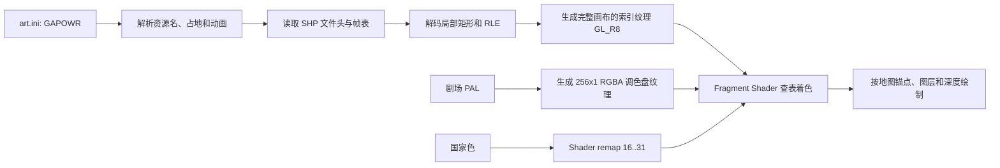
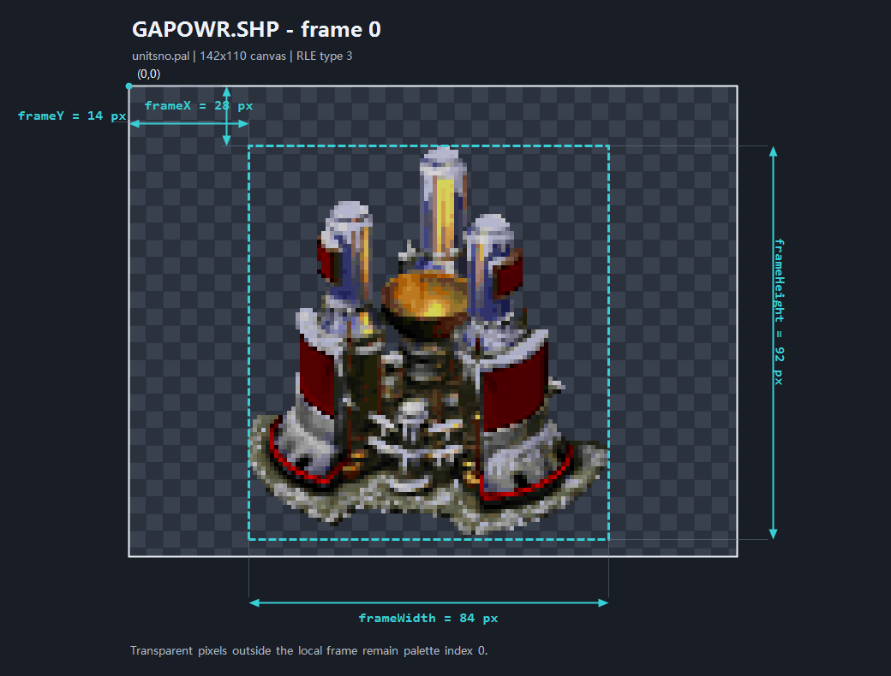

# 从零复刻《红色警戒 2》：以盟军电厂为例渲染 SHP 建筑

> 本文是 RA2 Replica 开发记录的第二篇。[上一篇](01-game-resource-extraction-and-organization.md)建立了原始资源池与运行时资源库，本篇开始真正显示游戏画面：读取 TS/RA2 SHP，解码帧数据，通过 PAL 得到颜色，并把盟军电厂 `GAPOWR` 对齐到等距地图上。

> 这是早期主项目拆解稿。当前隔离教学系列第二篇请阅读 [静态资源渲染](02-static-resource-rendering.md)。2026-10-10 已同步本页定位公式；其余历史实现说明以对应日期为准。

## 1. 最终要解决什么问题

我们希望从以下原版资源得到一座完整、可切换剧场与国家色、能够播放动画的盟军电厂：

```text
assets/settings/art.ini
assets/buildings/allied/gapowr/
├── gapowr.shp       # 雪地/通用主体
├── ggpowr.shp       # 温带主体
├── gapowr_a.shp     # 雪地/通用工作动画
├── ggpowr_a.shp     # 温带工作动画
├── gapowrmk.shp     # 雪地建造动画
├── gtpowrmk.shp     # 温带建造动画
└── gupowrmk.shp     # 城市建造动画
```

对应的渲染链路是：



这里有两个容易混淆的概念：

- SHP 负责保存“哪个像素使用哪个颜色编号”；
- PAL 负责说明“这个编号最终是什么颜色”。

因此，正确解析 SHP 只是完成了一半。调色盘、剧场、阵营色或透明规则错误时，轮廓仍然正确，但颜色会明显失真。

## 2. 从 art.ini 找到盟军电厂的组成

`rules.ini` 中的 `[GAPOWR]` 定义电厂的生命值、价格和发电量等游戏逻辑；真正决定图像如何组合的是 `art.ini`：

```ini
[GAPOWR]
Normalized=yes
Remapable=yes
Cameo=POWRICON
Foundation=2x2
Buildup=GAPOWRMK
NewTheater=yes
Height=4
ActiveAnim=GAPOWR_A
ActiveAnimZAdjust=-32
ActiveAnimYSort=362
OccupyHeight=3
```

这些字段对当前渲染器的意义如下：

| 字段 | 作用 |
| --- | --- |
| `Foundation=2x2` | 电厂从起始格占据 4 个逻辑格，不生成额外的经验图片偏移 |
| `Buildup=GAPOWRMK` | 建造阶段播放的 SHP |
| `ActiveAnim=GAPOWR_A` | 完成后叠加在主体上的循环动画 |
| `NewTheater=yes` | 根据温带、雪地、城市剧场替换文件名 |
| `Remapable=yes` | 调色盘索引 `16..31` 可以替换为国家色 |
| `Height`、`OccupyHeight` | 原版用于高度与占用语义；不是 SHP 像素高度 |
| `ActiveAnimZAdjust`、`ActiveAnimYSort` | 原版图层排序参数；当前实现主要依靠逻辑深度与显式图层顺序 |

`[GAPOWR_A]` 又描述工作动画本身：

```ini
[GAPOWR_A]
Image=GAPOWR_A
NewTheater=yes
Start=0
LoopStart=0
LoopEnd=8
LoopCount=-1
Rate=220
```

当前实现把完成态组装为两层：主体 `GAPOWR/GGPOWR` 在下，工作动画 `GAPOWR_A/GGPOWR_A` 在上。资源目录中虽然还有 `gapowr_b.shp`，但它没有被 `[GAPOWR]` 的当前完成态配置引用，不能因为文件名前缀相同就无条件叠加。

## 3. SHP 不是普通位图

TS/RA2 SHP 是逐帧的 8 位索引色图像。它不会给每个像素保存 RGBA 四个通道，而只保存一个 `0..255` 的调色盘索引。

假设某个像素值是 `57`：

```text
SHP 像素值 57
      ↓
PAL.colors[57]
      ↓
RGB565 量化后的 RGBA
      ↓
屏幕颜色
```

一个索引只需 1 字节，RGBA 则需要 4 字节。更重要的是，保留索引后可以在运行时更换 PAL 或国家色，不必重新解码整张 SHP。

SHP 还使用“全局画布 + 局部帧矩形”。每一帧通常只压缩实际可能出现像素的区域，而不是反复保存整张透明画布。这能显著减小动画文件体积，但要求渲染器在解码后恢复到统一画布，否则不同帧和不同图层会跳动。

## 4. SHP 的二进制结构

项目解析的是 Tiberian Sun / Red Alert 2 使用的 SHP 变体，所有多字节整数按小端序读取。

### 4.1 文件头：8 字节

```text
偏移  长度  类型    含义
0x00   2    u16     固定为 0，用于识别 TS/RA2 SHP
0x02   2    u16     全局画布宽度
0x04   2    u16     全局画布高度
0x06   2    u16     帧数量
```

解析器首先检查文件至少有 8 字节，并验证开头的 `u16` 为 0。这个判断很重要，因为不同 Westwood 游戏使用过名字相同但结构不同的 SHP 格式。

### 4.2 帧表：每帧 24 字节

文件头后紧跟 `frameCount` 个帧描述项：

```text
偏移  长度  类型    含义
+0x00  2    u16     frameX：局部矩形在全局画布中的 X
+0x02  2    u16     frameY：局部矩形在全局画布中的 Y
+0x04  2    u16     frameWidth
+0x06  2    u16     frameHeight
+0x08  4    u32     flags / 压缩类型
+0x0C  8            格式保留字段，当前渲染链路不使用
+0x14  4    u32     帧像素数据在文件中的绝对偏移
```

当前解析器支持三种标记：

| `flags` | 当前处理方式 |
| --- | --- |
| `0x0` | 按未压缩行读取 |
| `0x1` | 按未压缩行读取 |
| `0x3` | 按行解码透明 RLE |

遇到尚未支持的类型会直接报错，而不是猜测格式后继续读取。资源解析器宁可尽早失败，也不应把越界数据当成像素上传给 GPU。

### 4.3 盟军电厂的真实数据

我们直接读取三个文件的帧表，得到：

| 文件 | 文件大小 | 全局画布 | 帧数 | 当前用途 |
| --- | ---: | ---: | ---: | --- |
| `gapowr.shp` | 16,416 B | `142x110` | 6 | 完成态主体，当前使用第 0 帧 |
| `gapowr_a.shp` | 49,480 B | `142x110` | 32 | 当前取第 `0..7` 帧循环 |
| `gapowrmk.shp` | 101,960 B | `142x110` | 50 | 当前取前 25 帧作为建造动画 |

`gapowr.shp` 第 0 帧的描述项是：

```text
全局画布：142 x 110
局部矩形：x=28, y=14, width=84, height=92
压缩标记：0x3
数据偏移：152
```



图中电厂像素由 `gapowr.shp` 第 0 帧真实解码，并使用 `unitsno.pal` 着色。白色边框是完整的 `142x110` 画布，青色虚线框是 SHP 实际保存的局部帧矩形。

也就是说，这一帧只保存 `84x92` 的局部区域。解码后必须把区域放回 `142x110` 画布的 `(28,14)`，其余像素填透明索引 0。

建造动画更能体现局部矩形的价值：第 0 帧只使用 `(54,75,32,18)`，随后建筑逐渐升起，局部矩形扩大；所有帧最终仍放回同一个 `142x110` 画布，因此屏幕锚点保持稳定。

## 5. 解码透明 RLE

解码一帧时，我们先创建完整画布：

```cpp
indices.assign(fullWidth * fullHeight, 0);
```

索引 0 是透明色，因此这一步同时完成透明背景初始化。之后只遍历局部矩形的 `frameHeight` 行。

对于 `flags=0x3` 的帧，每一行具有自己的压缩长度：

```text
u16 compressedLength
compressedLength - 2 字节的行数据
```

行数据的核心规则是：

- 普通非零字节：把该值写入当前像素，然后 `x += 1`；
- `0, count`：跳过 `count` 个透明像素，不向画布写入数据；
- 空行：保持整行索引为 0；
- 写入位置必须加上 `frameX` 和 `frameY`。

简化后的伪代码如下：

```cpp
for each localY in frameHeight:
    read compressedLength
    x = 0

    while payload has data and x < frameWidth:
        value = readByte()
        if value == 0 and nextByte > 0:
            x += readByte()          // 一段透明像素
        else:
            canvas[(frameY + localY) * fullWidth + frameX + x] = value
            x += 1
```

当前实现还记录每行的非透明区段 `RowSpan/RowSegment`。它们不是得到颜色所必需的数据，但可以用于像素命中测试、轮廓分析和更精细的建筑遮挡研究。

解码器在每一步都检查：帧数据偏移是否越界、行长度是否合法、行 payload 是否超出文件、局部矩形是否能写入全局画布。这些检查比最终出现一张“花屏”更容易定位问题。

## 6. PAL：从索引得到最终颜色

SHP 本身没有调色盘。盟军电厂属于地图中的建筑，当前按剧场使用：

| 剧场 | 单位/建筑 PAL | 地形 PAL |
| --- | --- | --- |
| 温带 | `unittem.pal` | `isotem.pal` |
| 雪地 | `unitsno.pal` | `isosno.pal` |
| 城市 | `uniturb.pal` | `isourb.pal` |

一个 PAL 正好有 `256 * 3 = 768` 字节。每种颜色按 `R、G、B` 三个 6 位有效通道保存，原始值通常位于 `0..63`。加载过程是：

```text
6 bit 通道
  ↓ value * 255 / 63
8 bit RGB
  ↓ 模拟原版 16 位高彩色
RGB565 量化
  ↓
8 bit RGBA 纹理中的显示值
```

红、蓝量化到 5 位，绿色量化到 6 位。最后再扩展回 8 位只是为了便于现代 OpenGL 纹理采样；有效色阶仍然具有 RGB565 的特征。

索引 0 被设置为 `alpha=0`，其他颜色默认 `alpha=255`。Fragment Shader 对索引 0 直接 `discard`，这样透明区域既不写颜色，也不写深度。

当前地图建筑调色盘还应用 `0.82` 的固定亮度系数，以接近游戏地图中的观感；索引 `240..254` 被视为全亮范围，不受这一亮度衰减影响，可用于灯光和发光像素。这个亮度值是当前项目的显示策略，不应误解为 SHP 文件格式的一部分。

## 7. 为什么上传索引纹理，而不是 RGBA

最直接的做法是 CPU 逐像素查询 PAL，生成 RGBA 图片后上传。但项目现在采用运行时 GPU 查表：

```text
SHP 解码结果       → GL_R8，width x height
当前剧场 PAL       → GL_RGBA8，256 x 1
国家色             → shader uniform
```

索引纹理只使用红色通道保存 `0..255`。上传时关闭行对齐并使用最近邻过滤：

```cpp
glPixelStorei(GL_UNPACK_ALIGNMENT, 1);
glTexImage2D(GL_TEXTURE_2D,
             0,
             GL_R8,
             width,
             height,
             0,
             GL_RED,
             GL_UNSIGNED_BYTE,
             indices.data());
```

`GL_NEAREST` 很关键。线性过滤会把相邻“索引编号”插值，例如把索引 20 和 80 混成 50，这不是颜色混合，而是在调色盘里错误地查了第三种颜色，最终会出现脏边和闪烁。

Fragment Shader 的查色过程可以简化为：

```glsl
int index = int(round(texture(indexTexture, uv).r * 255.0));
if (index == 0) {
    discard;
}
vec4 color = texelFetch(paletteTexture, ivec2(index, 0), 0);
```

这样切换温带、雪地或城市时，只需更新一张 `256x1` 的 PAL 纹理，不需要重建几百张建筑帧纹理。这也是后来剧场切换优化能够消除明显卡顿的基础。

## 8. 国家色 remap

在允许阵营色的 SHP 中，索引 `16..31` 是 remap 色带。它们不是固定显示为 PAL 中的颜色，而是在 shader 中换成当前国家色的 16 级明暗。

当前实现使用：

```glsl
float stage = 1.0 - float(index - 16) / 15.0;
color.rgb = houseColor.rgb * stage;
```

因此索引 16 最接近完整国家色，索引 31 最暗，中间形成通向黑色的亮度梯度。切换国家色只更新 `uRemapColor`，SHP 索引纹理保持不变。

这也是保留索引纹理的第二个重要收益：国家色变化从“重新解码并上传所有建筑纹理”变成了一个很小的 uniform 更新。

## 9. 剧场文件名替换

`NewTheater=yes` 表示不能永远加载字面上的 `gapowr.shp`。当前资源定位器会根据第二个字符选择候选文件，并在缺失时按顺序回退。

对盟军电厂来说，当前实际映射大致是：

| 阶段 | 温带 | 雪地 | 城市 |
| --- | --- | --- | --- |
| 主体 | `ggpowr.shp` | `gapowr.shp` | 优先 `gupowr.shp`，缺失时回退 `ggpowr.shp` |
| 工作动画 | `ggpowr_a.shp` | `gapowr_a.shp` | 按候选顺序回退到已有变体 |
| 建造动画 | `gtpowrmk.shp` | `gapowrmk.shp` | `gupowrmk.shp` |

剧场切换包含两个独立动作：选择正确的 SHP 变体，以及上传正确的 PAL。只做其中一个，最终结果都不完整。

## 10. 把 SHP 对齐到 `2x2` 地块

解码后的纹理大小是 `142x110`，地图格则是 `60x30` 的等距菱形。我们不缩放建筑 SHP，而是寻找“贴图中的地图锚点”，再把它对齐到建筑逻辑格的锚点。

占地起始格是西北第一格，整数地图坐标表示格中心。建筑各层的完整画布中心对齐到起始格上顶点：

```text
cellCenter = isoToScreen(buildingStartCell)
drawCenter = cellCenter - (0, tileHeight / 2)
spriteTopLeft = drawCenter - (frame.width / 2, frame.height / 2)
```

宽高使用整数除法。对 60×30 格子、142×110 电厂，等价的格中心锚点为 `(71,70)`，默认 1280×720 窗口中左上角为 `(569,290)`。主楼、地台、工作层和建造帧使用同一个绘图中心，但各自减去自己的画布中心，再加配置的图层位移。

旧的 `+14 px` 及按占地大小分类的经验表已经删除。规则来源和迁移依据见 [建筑定位调研](../building-placement-research-2026-10-10.md)。

## 11. 顶点着色器和片元着色器分别做什么

Renderer2D 为一张 SHP 帧准备 6 个顶点，也就是两个三角形。每个顶点包含：

```text
屏幕位置 x, y
深度 z
纹理坐标 u, v
整体颜色 r, g, b, a
```

顶点着色器把像素坐标转换到 OpenGL 的 `[-1,1]` 标准设备坐标：

```glsl
vec2 ndc = vec2((position.x / viewport.x) * 2.0 - 1.0,
                1.0 - (position.y / viewport.y) * 2.0);
```

片元着色器则负责：

1. 从 `GL_R8` 纹理读取 SHP 索引；
2. 丢弃索引 0；
3. 从 `256x1` PAL 纹理查出 RGBA；
4. 对 `16..31` 应用国家色；
5. 乘以预览透明度或整体 tint；
6. 计算该建筑像素的逻辑深度；
7. 输出最终颜色。

世界 pass 开启 alpha blending 和深度测试：

```cpp
glBlendFunc(GL_SRC_ALPHA, GL_ONE_MINUS_SRC_ALPHA);
glEnable(GL_DEPTH_TEST);
glDepthFunc(GL_LEQUAL);
```

UI pass 则关闭深度测试，避免侧栏被地图内容遮挡。

## 12. 建筑像素深度

单纯给整张 SHP 一个深度值，会导致高大建筑与前后移动的载具发生错误遮挡。当前项目为每张建筑索引纹理额外生成一张同尺寸的 `GL_RG32F` 纹理：每个非透明像素记录它相对建筑地图锚点的屏幕偏移。

Fragment Shader 将偏移反解为等距地图逻辑坐标：

```text
屏幕偏移 (sx, sy)
      ↓  除以半格宽、半格高
等距坐标逆变换
      ↓
逻辑偏移 (dx, dy)
      ↓  选择最近的建筑占地格
逻辑深度
```

最后写入 `gl_FragDepth`。透明像素已提前 `discard`，不会留下一个覆盖整张矩形的不可见深度面。

需要注意，这种“从像素反推最近占地格”的方法仍是工程近似。SHP 文件并没有保存每个像素属于哪个地块，因此无法仅凭 SHP 绝对准确地恢复三维空间位置。本文重点是 SHP 解码与显示，复杂建筑和载具之间的遮挡还需要额外的逻辑分层与重绘 pass 配合。

## 13. 电厂的三种运行状态

当前 `BuildingInstance` 有 `Preview`、`Constructing`、`Packing` 和 `Complete` 四种状态。盟军电厂主要使用前三种显示路径：

### 建造中

`gapowrmk.shp` 有 50 帧，该类资源后半段通常包含与可见动画配套的阴影帧。当前实现取前 25 帧，每帧显示 50 ms，总时长约 1.25 秒；此时只画建造帧，不叠加完成态工作动画。

### 完成态

先绘制主体第 0 帧，再叠加 `gapowr_a.shp` 的前 8 帧。当前实现把 `Rate=220` 直接作为毫秒级帧间隔使用，并无限循环。这里描述的是本项目当前行为，不代表对原版时间单位的最终定论。

### 放置预览

使用完成态的全部图层，但给顶点颜色乘上半透明 tint。由于主体与动画都保留索引纹理，预览仍可以正确使用剧场 PAL 和国家色。

## 14. 缓存策略

SHP 解析和纹理上传不应发生在每一帧。当前实现分为三层缓存：

- 文件索引缓存：递归扫描 `assets/buildings` 一次，以小写文件名建立路径索引；
- 解码帧缓存：同一路径的 SHP 只读取和解码一次；
- 建筑资源缓存：按剧场缓存已加载的 `BuildingAsset`，按需创建建筑纹理。

国家色不进入建筑资源缓存 key，因为 remap 已经在 shader 中完成。剧场仍需要参与缓存，因为它可能选择不同 SHP 文件；单纯切换 PAL 不能替代剧场图像变体。

目前每个动画帧对应一张独立 OpenGL 纹理。这种结构简单、易调试，但动画种类继续增加后，可以考虑改成 texture array 或 atlas，减少纹理对象和绑定次数。

## 15. 常见错误与定位方法

| 表现 | 优先检查 |
| --- | --- |
| 文件被识别为非法 SHP | 文件头前 2 字节是否为 0，是否误用了其他代际 SHP |
| 图像像电视雪花 | 帧数据偏移、行长度或 RLE 的 `0,count` 处理错误 |
| 图层位置跳动 | 是否把局部矩形当成整帧纹理，是否丢失 `frameX/frameY` |
| 建筑有矩形底色 | 索引 0 是否透明并在 shader 中 discard |
| 轮廓正确但颜色怪异 | 是否选错 PAL，6 位通道是否正确展开 |
| 国家色不变化 | 是否保留原始索引，`16..31` remap 是否启用 |
| 边缘出现杂色 | 索引纹理是否误用了线性过滤 |
| 切换剧场只有颜色变化 | `NewTheater` 文件名替换是否生效 |
| 建造动画后半段像黑影 | 是否把阴影帧当成普通动画帧播放 |
| 建筑与网格错位 | `Foundation`、地图锚点和贴图锚点是否使用同一约定 |
| 建筑挡住前方载具 | 透明像素是否写深度，建筑是否需要逻辑分层或重绘 |

## 16. 当前实现的边界

为了让读者能够区分“格式事实”和“项目策略”，当前仍有几项值得继续完善：

- 解析器目前只支持 `flags=0、1、3`，遇到其他压缩类型会报错；
- 帧表中两个保留字段尚未参与渲染；
- 建造 SHP 的可见帧/阴影帧分组目前按前后半段处理，后续可按更多对象验证；
- `Rate` 当前按毫秒解释，尚未完整复刻原版游戏 tick 语义；
- 损坏态、废墟帧和原版 SHP 阴影尚未完整接入盟军电厂状态机；
- 普通矩形 footprint 已统一为起始格定位，原版特殊占地和自定义占地仍待实现；
- 像素逻辑深度是近似结果，不能替代建筑专用的遮挡层设计。

对应代码入口如下：

- 最小的单文件 CPU 教学示例：[`experiment/shp-render/src/main.cpp`](../../experiment/shp-render/src/main.cpp)
- SHP 文件读取与 RLE 解码：[`src/shp_ts.cpp`](../../src/shp_ts.cpp)
- PAL、RGB565 与 remap 色带：[`src/palette.cpp`](../../src/palette.cpp)
- 建筑资源组装与缓存：[`src/building_system_runtime.cpp`](../../src/building_system_runtime.cpp)
- SHP 对齐、图层和深度：[`src/iso_world.cpp`](../../src/iso_world.cpp)
- GPU 调色盘查表：[`src/renderer2d.cpp`](../../src/renderer2d.cpp)

## 17. 小结

盟军电厂的渲染可以归纳成六步：

1. 从 `art.ini` 得到主体、建造动画、工作动画、占地和剧场规则；
2. 读取 SHP 全局头和每帧 24 字节描述项；
3. 解码局部矩形与行级 RLE，恢复到统一的 `142x110` 索引画布；
4. 把索引上传为 `GL_R8`，把当前 PAL 上传为 `256x1 GL_RGBA8`；
5. 在 shader 中处理透明色、PAL 查表、国家色和亮度；
6. 根据 `2x2` footprint 对齐贴图，按状态、图层与逻辑深度绘制。

理解这条链路后，建筑、步兵、UI、cameo 和爆炸特效的 SHP 都可以复用同一个基础解析器。它们之间的主要区别不在文件格式，而在于使用哪张 PAL、如何解释帧序列，以及怎样放入各自的坐标与遮挡系统。
