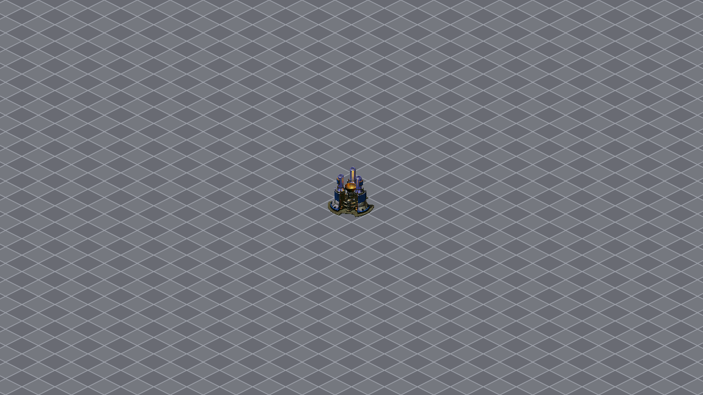
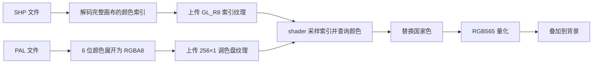

# 用现代 C++ 重建《红色警戒 2》（二）：静态资源读取与纹理渲染

上一篇建立了 SDL 窗口、OpenGL 绘制循环和菱形网格。现在，我们把第一座盟军电厂放进画面：读取原版 SHP 图片，通过 PAL 调色盘还原颜色，再把图片上传为 OpenGL 纹理。

本篇对应 `experiment/02-static-resource-rendering`。延续第一篇的写法，窗口与事件循环仍放在 `main`，GLSL 单独保存。`Building` 统一管理建筑的素材、图层、动画和网格定位，`Shader`、`Texture`、`VertexArray` 分别管理 OpenGL 对象。SHP 解析由 `shp.hpp` 的 `ShapeFile` 负责，调色盘处理由 `palette.hpp` 的 `Palette` 负责，方便先看懂“怎么画”，再研究“怎么读”。

本篇显示电厂的常态动画：两份 SHP 的全部帧在启动时读入，主体保持第 0 帧，上层在第 0～7 帧之间循环。建造、损坏等建筑状态放在后续章节。



## 一 本篇的文件和运行方式

```text
experiment/02-static-resource-rendering/
├── main.cpp
├── main2.cpp
├── building.hpp
├── vertex_array.hpp
├── shader.hpp
├── texture.hpp
├── shp.hpp
├── palette.hpp
├── CMakeLists.txt
├── README.md
├── shaders/
│   ├── grid.vert
│   ├── grid.frag
│   ├── sprite.vert
│   └── sprite.frag
└── assets/
    ├── ggpowr.shp
    ├── ggpowr_a.shp
    └── unittem.pal
```

`main.cpp` 创建建筑列表，在循环中先画网格，再遍历列表调用 `Building::draw`。建筑内部按图层参数选择图片并依次叠加。看懂这个顺序后，再进入 `building.hpp` 了解图层管理和纹理上传，进入 `shp.hpp` 了解 SHP 解码，进入 `palette.hpp` 了解调色盘处理。`main2.cpp` 是使用同一套 `Building` 的参考入口，保留另一种资源路径写法。

本篇使用 C++20、SDL2、OpenGL 3.3 Core 和仓库提供的 GLAD。`grid.vert` 用两个三角形铺满窗口，`grid.frag` 沿用第一篇的网格。新增的两个 `sprite` shader 负责图片的位置和颜色。

在 CLion 中打开仓库根目录，重新加载 CMake 后选择 `ra2_02_static_resource_rendering`，即可编译运行 `main.cpp`，显示完整电厂常态动画。也可以直接打开本篇目录作为独立项目。

在已经配置 CMake 和编译器的终端中，从仓库根目录执行：

```powershell
cmake -S experiment/02-static-resource-rendering -B build-02-static-resource-rendering
cmake --build build-02-static-resource-rendering --config Debug --parallel
cmake --build build-02-static-resource-rendering --config Debug --target run
```

程序支持调整窗口大小，按 Esc 或关闭窗口退出。CMake 每次构建都会把 GLSL 和素材复制到可执行文件旁边。完整示例 `main2.cpp` 通过 `SDL_GetBasePath()` 定位这些资源；当前 `main.cpp` 使用相对路径，运行时应以本篇目录或含有 `shaders` 的可执行文件目录为工作目录。

每篇示例有自己的代码和素材副本；本篇只共享第三方依赖，不链接主游戏或第一篇的应用代码。

## 二 从 SHP 和 PAL 得到一张图片

普通 RGBA 图片为每个像素保存红、绿、蓝和透明度四个数。红警 2 的许多图片采用索引色：SHP 为像素保存一个颜色编号，PAL 保存编号对应的颜色。

例如，SHP 中某个像素的值为 `57`，表示查找调色盘的第 57 项，而不是“灰度为 57”。它的最终 RGB 颜色由 PAL 决定。

本篇使用三个文件：

| 文件 | 大小 | 完整画布 | 帧数 | 使用方式 |
|---|---:|---:|---:|---|
| `ggpowr.shp` | 16,416 字节 | 142×110 | 6 | 全部读取，常态显示第 0 帧 |
| `ggpowr_a.shp` | 49,480 字节 | 142×110 | 32 | 全部读取，常态循环第 0～7 帧 |
| `unittem.pal` | 768 字节 | — | — | 256 项 RGB 调色盘 |

两个 SHP 文件的像素都使用同一张温带单位调色盘。主体与上层分别解码后，将各自的画布中心对齐到同一个绘图中心，叠加显示。本篇先将 PAL 的颜色展开为 RGBA8，再由 shader 查表、替换国家色，最后做 RGB565 量化。

整体流程如下：



CPU 解码后仍保留每个像素的颜色编号，GPU 收到两种纹理：一张保存编号，一张保存编号对应的颜色。这与主项目的建筑绘制路径相同；以后切换国家色时，只需更新一个 shader 参数，不需要重新解码整张 SHP。

## 三 读取 SHP 的完整画布和局部帧

### 文件头与帧表

本篇解析的是 Tiberian Sun / Red Alert 2 使用的 SHP 变体。多字节整数按小端序保存，即低位字节放在前面。文件首先包含 8 字节的头部：

| 偏移 | 字节数 | 含义 |
|---|---:|---|
| 0 | 2 | 格式标记，值为 0 |
| 2 | 2 | 完整画布宽度 |
| 4 | 2 | 完整画布高度 |
| 6 | 2 | 帧数量 |

头部之后是帧表，每个条目占 24 字节。本篇使用以下字段：

| 相对条目起点的偏移 | 字节数 | 含义 |
|---|---:|---|
| 0 | 2 | 局部帧的 X 偏移 |
| 2 | 2 | 局部帧的 Y 偏移 |
| 4 | 2 | 局部帧宽度 |
| 6 | 2 | 局部帧高度 |
| 8 | 1 | 压缩类型 |
| 9 | 11 | 本篇不使用的字段 |
| 20 | 4 | 像素数据在文件中的绝对偏移 |

这套字段布局也可以对照 [OpenRA 的 SHP TS 解析实现](https://github.com/OpenRA/OpenRA/blob/bleed/OpenRA.Mods.Common/SpriteLoaders/ShpTSLoader.cs)。注意压缩类型只取一个字节，不应把后面的字段一起解释成压缩类型。

代码显式读取小端整数，避免直接把文件内存强转成 C++ 结构体。比如 16 位数的计算为：

\[
v=b_0+256b_1
\]

对应的函数是：

```cpp
static U16 readU16(const Bytes& bytes, std::size_t offset) {
    return bytes[offset] | (bytes[offset + 1] << 8);
}
```

这个函数定义在 `shp.hpp` 中，`U16` 是 `std::uint16_t` 的别名。当前简化版使用下标直接读取，假定输入是本篇提供的有效素材。调用者只需构造对象，就会读入文件并解码全部帧：

```cpp
const ShapeFile shp("assets/ggpowr_a.shp");
const auto width = shp.width;
const auto height = shp.height;
const auto frameCount = shp.frameCnt;
const ByteMatrix& firstFrame = shp.pixels[0];
const auto paletteIndex = firstFrame[14][48]; // 第 14 行、第 48 列，从 0 开始。
```

公开成员 `width`、`height`、`frameCnt` 保存文件头的信息，`pixels` 保存所有帧。构造函数只读取一次文件，在循环中依次读取帧头、解码像素，再通过 `pixels.push_back(std::move(image))` 保存完整画布。帧表中有多少帧，就解码多少帧；动画播放范围由建筑图层参数另行决定。这里的 `firstFrame` 是引用，不复制像素，因此应在对象存活且未被重新赋值期间使用。

### 为什么局部帧不能直接当成整张图片

`ggpowr.shp` 第 0 帧的完整画布是 142×110，但保存的局部矩形为：

\[
(x_f,y_f,w_f,h_f)=(28,14,84,92)
\]

解码时先创建透明画布，再把 84×92 的局部数据放回画布的 `(28,14)`。局部像素 `(x,y)` 对应的完整画布坐标为：

\[
\boxed{x_{canvas}=x_f+x,\qquad y_{canvas}=y_f+y}
\]

每帧显式保存成二维矩阵。先创建 `height` 行，每行 `width` 个透明像素，再把解码后的一行复制到目标行的 `frameX` 列开始的位置：

```cpp
ByteMatrix image(height, Bytes(width, 0));
// 在逐行解码循环中，row 是局部帧的第 y 行。
std::copy(row.begin(), row.end(), image[frameY + y].begin() + frameX);
```

对应单个像素，就是写入 `image[frameY + y][frameX + x]`。第一个下标表示行，第二个表示列。类型 3 进入 RLE 解码分支；本篇使用的类型 0、1 数据可以直接复制。

上层第 0 帧的局部矩形则是 `(48,14,44,83)`，完整画布同样为 142×110。如果分别裁出两个局部矩形，再把它们左上角对齐，上层图像就会错位。恢复完整画布后，将各自画布中心对齐即可。这里两层画布恰好同样大，所以左上角也相同；不同尺寸的附层不能复用主体左上角。

## 四 解码透明 RLE

本篇两份 SHP 使用类型 `3`，需要按行解码透明 RLE。当前简化版将非 3 类型按未压缩像素读取，适用于这里讨论的类型 `0`、`1`，没有完整的未知格式校验。

RLE 的每一行先保存一个 16 位长度。长度包含它自身占用的两个字节，剩余部分才是行数据：

```text
[两个字节的行长度] [这一行的编码数据]
```

编码数据有两种含义：

- 非零字节：当前像素使用这个颜色编号，向右移动一格。
- 零字节：下一个字节表示连续透明像素的数量，跳过对应位置。

例如，行数据为：

```text
编码：5, 0, 3, 7
解码：5, 0, 0, 0, 7
```

中间的 `0,3` 表示三个透明像素。完整画布已经初始化为零，因此透明段只需要增加横坐标，不必逐个写入。

解码时需要分别维护“输入文件读到哪里”和“输出图片写到哪里”。代码中的 `j` 是行数据的输入游标，`cur` 是画布上的输出横坐标。输入游标每次前进一个或两个字节，输出横坐标则可能一次跳过多个像素。处理完当前行后，`offset += length` 移到下一行。

当前教学解析器围绕本篇的有效素材编写，没有完整的行长度、文件边界和异常数据校验。它帮助理解格式；要读取任意外部 SHP，还需补充这些检查。

## 五 读取调色盘

PAL 文件有 256 个颜色，每个颜色依次保存 R、G、B 三个字节，总长度为：

\[
256\times3=768\text{ 字节}
\]

这些通道值使用 6 位范围，即 0 到 63。我们把它们展开到 RGBA8 使用的 0 到 255：

\[
\boxed{c_8=\left\lfloor\frac{255c_6}{63}\right\rfloor}
\]

`palette.hpp` 的 `Palette` 构造函数读取文件，然后转换颜色。本篇的 PAL 有 256 项：

```cpp
size = bytes.size() / 3;
rgba.resize(size * 4);
for (int index = 0; index < size; ++index) {
    for (int channel = 0; channel < 3; ++channel)
        rgba[index * 4 + channel] = bytes[index * 3 + channel] * 255 / 63;
    rgba[index * 4 + 3] = index == 0 ? 0 : 255;
}
```

PAL 不保存 Alpha。为了绘制 SHP，我们让索引 0 为透明色，Alpha 为 0，其他索引的 Alpha 为 255。

这个加载器只做文件读取和颜色转换。国家色替换和 RGB565 量化在 shader 中处理，CPU 保存的调色盘数据不参与额外亮度计算。

处理后的调色盘只有 `256×4=1024` 字节，由 `Palette` 的公开成员 `rgba` 保存，`size` 表示颜色数量。当前简化版加载器假定使用本篇提供的有效 PAL 文件，没有完整的异常数据校验。`ShapeFile` 中的 SHP 图片自身仍保存索引：

```cpp
using Bytes = std::vector<std::uint8_t>;
using ByteMatrix = std::vector<Bytes>;
std::vector<ByteMatrix> pixels;
// pixels[帧编号][y][x] 就是该像素的颜色编号。
```

每帧矩阵按行保存索引，每个像素只有一个字节。这两份 CPU 数据接下来分别上传到 GPU。

## 六 将图片上传为 OpenGL 纹理

`texture.hpp` 中的 `Texture` 类管理一个 OpenGL 纹理编号，构造时上传数据，析构时释放。`Building` 使用这些纹理管理任意数量的 SHP 图层。电厂由两个图层描述：

```cpp
Building powerPlant("assets/unittem.pal", {
    {"assets/ggpowr.shp"},
    {"assets/ggpowr_a.shp", 0, 8, 7}
});
```

构造 `Building` 时，为每个图层构造 `ShapeFile`，再由内部 `loadFrames` 遍历全部帧。二维 `vector` 的各行分别分配内存，而 OpenGL 接收连续的像素数据，因此上传前按从上到下的顺序拼接各行：

```cpp
Bytes indices;
indices.reserve(std::size_t(shp.width) * shp.height);
for (const auto& row : frame)
    indices.insert(indices.end(), row.begin(), row.end());
textures.emplace_back(shp.width, shp.height, GL_RED, indices);
```

这里的 `frame` 是当前帧的二维矩阵。每个 SHP 帧对应一张索引纹理，各图层共用建筑的调色盘纹理。图层文件中的全部帧都会上传，实际绘制范围由配置选择。SHP 类保存便于理解的二维像素矩阵，`Texture` 负责上传和管理 OpenGL 纹理。

`Building` 内部的 `Art` 保存调色盘纹理和已上传的图层，实例通过 `std::shared_ptr<const Art>` 引用它。复制一个已经加载的建筑时，两者共享只读素材，地图位置、国家色和地面高度仍各自保存；最后一个实例销毁后才释放素材。独立调用构造函数则会重新加载文件，当前没有按路径自动缓存。

构造函数根据输入通道数选择存储格式：

```cpp
glPixelStorei(GL_UNPACK_ALIGNMENT, 1);
glTexImage2D(GL_TEXTURE_2D, 0, format == GL_RED ? GL_R8 : GL_RGBA8, width, height, 0,
             format, GL_UNSIGNED_BYTE, pixels.data());
glPixelStorei(GL_UNPACK_ALIGNMENT, 4);
```

`GL_RED` 表示输入只有一个通道，对应的 `GL_R8` 每像素保存一个 8 位值；这里用它存颜色编号，并不是把图片染红。`GL_RGBA` 对应四通道输入，`GL_RGBA8` 保存处理后的调色盘颜色。`GL_UNSIGNED_BYTE` 表示输入通道使用无符号字节。[Khronos 的 glTexImage2D 说明](https://github.com/KhronosGroup/OpenGL-Refpages/blob/main/gl4/glTexImage2D.xml)

`GL_UNPACK_ALIGNMENT` 告诉 OpenGL 怎样寻找下一行的起点。默认值为 4，但索引图片每行恰好 142 字节，没有额外补齐到 144 字节；因此上传前改为 1，按紧密排列的数据读取，完成后恢复为 4。否则第二行开始就可能错位。

上传完成后，GPU 保存自己的数据，CPU 的图片数据可以释放。后面的每帧绘制不需要重新读取 SHP、处理调色盘或上传纹理；颜色查表由 shader 在绘制时完成。

本篇使用最近邻过滤：

```cpp
glTexParameteri(GL_TEXTURE_2D, GL_TEXTURE_MIN_FILTER, GL_NEAREST);
glTexParameteri(GL_TEXTURE_2D, GL_TEXTURE_MAG_FILTER, GL_NEAREST);
```

最近邻过滤直接选择附近的纹理像素。对于索引纹理，这不只是画面风格的选择：颜色编号不能像 RGB 那样插值。例如编号 10 和 20 的中间值 15，可能对应完全无关的颜色。缩小和放大都明确使用最近邻过滤，不生成 mipmap；边缘模式使用 `GL_CLAMP_TO_EDGE`，避免采样越过边缘时重复另一侧的图片。

shader 需要同时读取两张纹理，因此使用两个纹理单元：

```cpp
spriteShader.setInt("uTexture", 0);
spriteShader.setInt("uPaletteTexture", 1);
```

`Building::draw` 中，`art_->palette.bind(1)` 把调色盘纹理绑定到第 1 号单元，各层当前帧的 `image.bind()` 默认把索引纹理绑定到第 0 号单元。shader 中的整数 `0` 和 `1` 指纹理单元，不是文件编号，也不是 OpenGL 纹理对象编号。

## 七 用两个三角形绘制图片

### UV 表示图片内部的位置

本篇继续通过 `gl_VertexID` 取得六个顶点，用它们组成两个三角形。图片使用以下局部坐标：

```glsl
const vec2 corners[6] = vec2[6](
    vec2(0.0, 0.0), vec2(1.0, 0.0), vec2(0.0, 1.0),
    vec2(1.0, 0.0), vec2(0.0, 1.0), vec2(1.0, 1.0)
);
```

这里约定 `(0,0)` 对应图片左上角，`(1,1)` 对应右下角。这套坐标也直接作为 UV，即“从图片的哪个位置采样”。绘制三角形时，GPU 会在顶点之间插值，得到内部片元的 UV。

CPU 解码的第一行上传到纹理的 `v=0` 一侧，而我们也将图片顶边对应到 `v=0`，所以不再翻转像素行或 UV。保持这两处约定一致，图片就不会上下颠倒。

### 从图片坐标到窗口坐标

设图片左上角为 \(\mathbf{P}\)，显示尺寸为 \(\mathbf{S}\)，局部坐标为 \(\mathbf{t}\)：

\[
\boxed{\mathbf{s}=\mathbf{P}+\mathbf{t}\odot\mathbf{S}}
\]

其中 \(\odot\) 表示逐分量相乘。对应代码为：

```glsl
textureUV = corners[gl_VertexID];
vec2 screen = uPosition + textureUV * uSize;
```

本篇令一张 142×110 的纹理显示为 142×110 个窗口单位。原版建筑图片本身已经表现出斜向观察效果，因此这里只需要显示一个普通矩形，不必再把图片压成菱形。

### 从窗口坐标到 OpenGL 坐标

窗口坐标原点在左上方，OpenGL 标准化设备坐标则以中心为零、Y 向上。设窗口宽高为 \((W_w,H_w)\)，转换关系是：

\[
\boxed{
n_x=\frac{2s_x}{W_w}-1,\qquad
n_y=1-\frac{2s_y}{H_w}
}
\]

对应 shader 的最后两行：

```glsl
vec2 ndc = screen / uWindowSize * 2.0 - 1.0;
gl_Position = vec4(ndc.x, -ndc.y, 0.0, 1.0);
```

`gl_Position.w` 为 1，所以后续除以 w 时数值不变。OpenGL 再按 `glViewport(0, 0, pixelWidth, pixelHeight)` 将这些位置映射到实际绘图像素。

这里图片顶点按窗口单位定位，视口按绘图像素设置。假如绘图区域的两个方向都是窗口的两倍，一张宽 142 个窗口单位的图片会覆盖 284 个绘图像素；它在窗口中的布局尺寸仍然是 142。不要在 CPU 端额外乘一次相同比例，否则会重复放大。[SDL 对窗口大小与绘图大小的说明](https://wiki.libsdl.org/SDL2/SDL_GL_GetDrawableSize)

### 片元 shader 查颜色和量化 RGB565

`GL_R8` 通过普通 `sampler2D` 采样时，会将字节归一化到 0～1。乘以 255 并取整，就能还原颜色编号，再从调色盘取出对应颜色：

```glsl
#version 330 core

uniform sampler2D uTexture;
uniform sampler2D uPaletteTexture;
uniform vec3 uRemapColor;
uniform bool uRemapable = true; // 是否替换国家色。
in vec2 textureUV;
out vec4 fragmentColor;

// 截取 RGB 的高 5/6/5 位，再展开为 shader 的 0～1 输出。
vec3 quantizeRgb565(vec3 rgb) {
    // 微小容差抵消 40.0 被浮点运算表示为 39.999996 一类的误差。
    ivec3 rgb8 = ivec3(clamp(rgb, 0.0, 1.0) * 255.0 + 0.0001);
    ivec3 rgb565 = rgb8 >> ivec3(3, 2, 3);
    return vec3(rgb565) / vec3(31.0, 63.0, 31.0);
}

void main() {
    int paletteIndex = int(round(texture(uTexture, textureUV).r * 255.0));
    if (paletteIndex == 0) discard;

    vec4 color = texelFetch(uPaletteTexture, ivec2(paletteIndex, 0), 0);
    // 索引 16～31 替换为国家色渐变。
    if (uRemapable && paletteIndex >= 16 && paletteIndex <= 31) {
        float stage = 1.0 - float(paletteIndex - 16) / 15.0;
        color.rgb = uRemapColor * stage;
    }
    color.rgb = quantizeRgb565(color.rgb);
    fragmentColor = color;
}
```

索引 0 执行 `discard`，让这个片元不写入颜色缓冲。`texelFetch` 则按整数坐标直接读取调色盘的第 `paletteIndex` 项；末尾的 `0` 表示第 0 级纹理，不进行颜色插值。

索引 16～31 用于国家色。主项目将这个区间替换为从国家色逐步变暗的渐变：

\[
t=1-\frac{i-16}{15},\qquad C_{remap}=t\,C_{country}
\]

示例实例使用主项目默认的 DarkBlue。`rules.ini` 中的 HSV `(153,214,212)` 经过主项目转换及量化后得到 RGB `(32,105,213)`，保存到建筑属性中，绘制时再除以 255 传给 shader：

```cpp
powerPlant.remapColor = {32, 105, 213, 255};
```

为保持教学代码独立，这里直接写入转换后的国家色，不读取主项目 `rules.ini`。国家色替换发生在调色盘查询之后，RGB565 量化发生在国家色替换之后。

shader 不需要再次反算地图坐标，因为三角形已经决定了图片出现在哪里，UV 已经决定了当前片元应该读取图片中的哪个位置。

### 为什么保留 RGB565

RGB565 是颜色精度的量化：红、蓝通道各保留 5 位，绿通道保留 6 位。shader 先将颜色转换为 8 位整数，再用右移去掉低位，最后除以 `(31,63,31)` 展开为 0～1 的输出颜色。

它在调色盘查表、国家色替换之后执行。所有非透明索引统一经过这一步；索引 0 仍由 `discard` 处理。窗口使用现代颜色缓冲，这里只模拟颜色精度，不是完整的原版 16 位帧缓冲。

## 八 将两层图片叠加在网格上

绘制顺序是网格、主体、上层图像。索引 0 已由 shader 丢弃，透明区域自然露出背景。本篇也沿用主项目的 Alpha 混合设置：

```cpp
glEnable(GL_BLEND);
glBlendFunc(GL_SRC_ALPHA, GL_ONE_MINUS_SRC_ALPHA);
```

对 RGB 通道，这组参数实现：

\[
\boxed{C_{out}=\alpha_s C_s+(1-\alpha_s)C_d}
\]

\(C_s\) 是当前图片颜色，\(C_d\) 是已经绘制的背景颜色。当源 Alpha 为 0 时保留背景；为 1 时使用图片颜色。[OpenGL 混合参数说明](https://learn.microsoft.com/en-us/windows/win32/opengl/glblendfunc)

地图坐标中的整数表示格子中心。建筑的逻辑位置采用占地的西北起始格；各层 SHP 的完整画布中心则对齐到这个格子的**上顶点**。因此，先求地图格中心 \(C\)，再向上移动半格高度，得到共同绘图中心 \(D\)：

\[
\boxed{D_x=C_x,\qquad D_y=C_y-\frac{H_t}{2}}
\]

这一步来自格子几何，与电厂是 2×2、图片有多高无关。OpenTS 的 `Render_Coord` 从格中心减去两个轴各半格；RA2 地图编辑器 WorldAlteringEditor 在屏幕空间减去半格高度。两者得到相同的上顶点。[OpenTS 建筑坐标](https://github.com/OpenTS-Developers/OpenTS/blob/103ff23b32a7214c304d4141a6e83eb255a74d01/code/building.cpp#L10486)、[WorldAlteringEditor 建筑偏移](https://github.com/Rampastring/WorldAlteringEditor/blob/36209485b8bc389bb6aaa08dd09e54eca3d8765b/src/TSMapEditor/Models/Structure.cs#L286)

每一层再减去**自己的**完整画布中心，得到图片左上角 \(P\)：

\[
\boxed{P_x=D_x-\left\lfloor\frac{W_i}{2}\right\rfloor,\qquad
P_y=D_y-\left\lfloor\frac{H_i}{2}\right\rfloor}
\]

这里使用整数除法，奇数尺寸也有确定的像素落点。SHP 的裁剪偏移已经在解码时写回画布，绘制时不能再加一次。

默认 1280×720 窗口中，起始格中心 \(C=(640,360)\)，格子高 30，故 \(D=(640,345)\)。142×110 电厂的画布中心是 `(71,55)`，图片左上角为 **`(569,290)`**。若换成“图片内哪个点落在格中心”的说法，等价锚点是 `(71,70)`。它由画布中心加半格高度得到，不再使用旧的 `+14` 偏移表。

`Building::draw` 先将实例的起始格 `cell` 投影到窗口，再求这个上顶点：

```cpp
const SDL_FPoint center{
    origin.x + (cell.x - cell.y) * tileSize.x / 2,
    origin.y + (cell.x + cell.y) * tileSize.y / 2 - tileSize.y / 2
};
```

`origin` 是地图坐标 `(0,0)` 的格中心，示例将它放在窗口中心。`cell={0,0}` 时，上式就变成中心向上移动 15；其他位置仍使用同一套投影。网格和建筑共用 `tileSize{60,30}`，修改格子尺寸时只需改这一处。

建筑内部依次绘制每个图层，各层减去自己的完整画布中心，再加上图层偏移：

```cpp
shader.setVec2("uPosition", center.x - image.width / 2 + config.offset.x,
              center.y - image.height / 2 + config.offset.y);
shader.setVec2("uSize", image.width, image.height);
image.bind();
vao.draw();
```

场景负责设置窗口大小和全局光照。`Building::draw` 负责选中图片 shader，绑定建筑自己的调色盘和实例参数，再对各层设置位置和尺寸、绑定索引纹理、绘制两个三角形。传入的图层顺序就是叠加顺序。

电厂图层的 `offset` 为 `(0,0)`。一般建筑的附属动画还需叠加对应槽位的 X/Y 和动画 `YDrawOffset`，可以将合并后的结果传入 `offset`；`ZAdjust`、`YSort` 影响遮挡或排序，不能加到图片位置上。完整 `art.ini` 配置读取留到建筑系统章节，规则来源及迁移说明见 [建筑定位调研](../building-placement-research-2026-10-10.md)。

### 用数据描述不同建筑

`BuildingLayer` 保存每个图层的差异，`Building` 保存通用绘制逻辑：

```cpp
struct BuildingLayer {
    std::string path;
    int firstFrame = 0;
    int frameCount = 1;
    int gameFramesPerImage = 1;
    SDL_FPoint offset{0, 0};
};
```

`frameCount=1` 表示静态图层；大于 1 时按时间循环指定范围。主体也可以使用多帧动画，附层也可以只显示一帧。图层可以有不同的画布尺寸和偏移，数量由传入列表决定。类中没有电厂文件名、8 帧循环或国家色的特殊分支。

场景中创建的是普通建筑实例：

```cpp
std::vector<Building> buildings;
buildings.emplace_back("assets/unittem.pal", std::vector<BuildingLayer>{
    {"assets/ggpowr.shp"},
    {"assets/ggpowr_a.shp", 0, 8, 7}
});
buildings.back().cell = {0, 0};
buildings.back().remapColor = {32, 105, 213, 255};
```

目前这些参数使用 C++ 初始化列表描述。更换建筑时提供另一组素材和图层参数即可，完整 INI 读取与建筑状态切换不在本篇实现。

同类建筑可以复制已有实例，共享上传好的素材，再设置自己的位置和国家色：

```cpp
Building another = buildings.front();
another.cell = {3, 1};
another.remapColor = {213, 32, 32, 255};
buildings.push_back(std::move(another));
```

这不会重新读入 SHP 或上传纹理。主循环只需遍历列表调用 `draw`；当前仍按列表顺序绘制，建筑间的遮挡排序和占地判定留给后续章节。

## 九 用经过的时间播放常态动画

两份文件分别读入 6 帧和 32 帧，但这些帧属于不同的用途。主体只需显示完整状态的第 0 帧；上层的正常工作动画由 `art.ini` 中的 `[GAPOWR_A]` 指定：

```ini
Start=0
LoopStart=0
LoopEnd=8
LoopCount=-1
Rate=220
Normalized=yes
```

正常循环使用第 0～7 帧。损坏态 `[GAPOWR_AD]` 的 `Start`、`LoopStart` 都是 8，范围为 `[8,16)`；后面的帧用于阴影。因此，读取全部帧后，仍需选择当前状态对应的播放区间。

示例把这个工作图层描述为 `{path, 0, 8, 7}`：起始帧为 0、循环帧数为 8、每 7 个游戏帧换图。场景时间节奏采用主项目默认对战 6 档的 60 游戏帧/秒。这对应 `Rate=220`、`Normalized=yes` 的现有校准结果，见 [动画节奏说明](../gameplay-calibration-2026-09-12.md)。`Rate=220` 不是每帧 220 毫秒。

场景先记录开始时间，每次绘制前计算经过了多少游戏帧，再将同一个时间传给建筑列表：

```cpp
const auto elapsed = SDL_GetTicks64() - start;
const auto gameFrame = elapsed * gameFramesPerSecond / 1000;
for (const auto& building : buildings)
    building.draw(spriteShader, vao, origin, tileSize, gameFrame);
```

`Building::draw` 为每个图层选择帧：

```cpp
const auto frame = config.firstFrame +
    (gameFrame / config.gameFramesPerImage) % config.frameCount;
```

`elapsed` 的单位是毫秒。乘 60、除以 1000 后得到游戏帧数。对电厂工作层而言，再除以 7 得到已经切换的图片数，最后对 8 取余，把编号限制为 `0,1,…,7,0,1,…`。一轮动画耗时 `8×7/60` 秒，约 0.933 秒。静态层的 `frameCount` 为 1，结果始终是 `firstFrame`。构造函数会检查区间和换帧间隔，避免越界读取和除以零。

图片编号根据经过的时间计算，窗口每秒绘制 30 次或 144 次都按同样的节奏播放。播放时只绑定已上传的纹理，不再读取 SHP 或重新上传像素。

## 十 每帧做什么以及何时释放资源

示例启动时创建 shader、VAO，以及建筑素材中的 38 张帧索引纹理和一张调色盘纹理。进入循环后，每帧依次处理事件、查询窗口与绘图大小、设置视口、计算游戏帧、绘制网格，再遍历建筑列表绘制各层，最后交换前后缓冲。正常绘制不会重新加载或上传素材。

由于网格覆盖整个视口，且输出不透明颜色，本例不需要额外清除颜色缓冲。图片随后通过混合叠加到这个背景上。

窗口、OpenGL 上下文与清理仍直接写在 `main`。GPU 对象声明在 `try` 作用域内，无论正常退出还是发生异常，都先析构纹理、VAO 和 shader，再销毁上下文。这一点很重要：删除 OpenGL 资源时，它们依赖的上下文应当仍然存在。

代码保留了读取失败、shader 编译或链接失败的错误输出。当前示例覆盖 SHP 全帧索引解码、PAL 颜色转换、GPU 查表、国家色、RGB565，以及通用建筑图层、地图定位和循环动画。动态阴影、建造和损坏状态、多物体遮挡排序、地形 TMP、建筑占地判定与游戏逻辑仍属于后续内容。

本篇沿用主项目的素材、定位规则，以及默认对战 6 档下的电厂常态动画节奏。本篇只保留调色盘、国家色和 RGB565，后续仍需与原版游戏校准。代码只链接第三方库，便于读者逐步理解这一条资源到画面的路径。

下一篇进入体素模型渲染。届时，建筑图片提供的纹理经验仍然有用，但载具模型还需要新的几何表示、朝向和光照处理。
