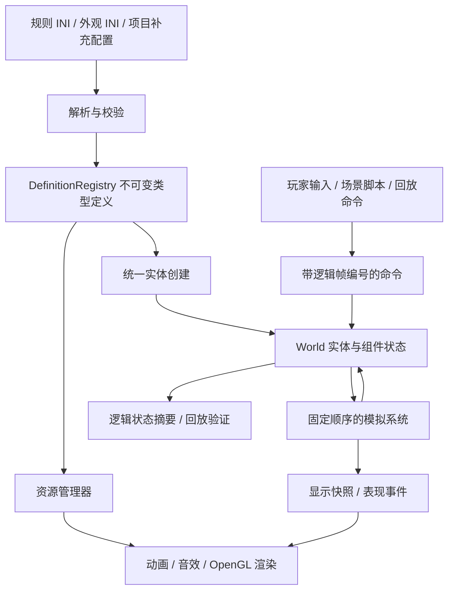

# 配置驱动单位系统：调研与实现方案

调研日期：2026-09-11。状态：基础系统与工厂内部出车已接入主程序，详见 [实现与验证记录](unit-system-implementation.md)。

M1/M2 与 M3 的基础地面战斗闭环已落地；M4 已接入基础队列、出口等待、内部出车和多实例部署，
M5 已迁移图层配置并由出车阶段驱动生产表现，M6 已建立无图形基准。
原版校准、完整状态动画及 GPU 批处理仍未完成；出车详情见 [实现记录](factory-egress-implementation.md)。

目标是还原红色警戒 2 原版的可观察行为与画面，并提高现代硬件上的性能。
方案基于当前 C++20、SDL2、OpenGL 3.3 项目，以及官方项目文档和源代码。
当前问题证据见 [单位系统审查](/F:/projects/ra2-replica/docs/unit-system-review-2026-09-11.md)。

## 1. 推荐决策

1. 保留 `rules.ini` 和 `art.ini`，建立一次解析、引用解析、校验和强类型编译的配置入口。
2. 采用“不可变类型定义 + 实体组件 + 明确调度的系统 + 命令状态机”。
3. 建议使用 **EnTT** 管理实体和组件，接入时锁定经过验证的发布版本；游戏调度、规则和确定性由本项目实现。
4. 使用 C++20 与 OpenGL 3.3 作为本轮迁移基线。新依赖固定版本，不追踪主分支。
5. 模拟采用固定逻辑步，显示独立插值；模拟核心不依赖 SDL、OpenGL、ImGui 或墙钟。
6. 保留已实现的素材解析、VPL/调色盘着色和建筑遮挡成果，通过表现配置与资源句柄接入。
7. 先完成犀牛、灰熊的配置、移动、战斗闭环，再迁移生产、基地车和建筑状态动画。

这是本项目的工程取舍。下文的调研事实用于支持取舍，不构成原版行为已经得到验证的证明。

## 2. 调研结果与适用范围

### OpenRA：参考能力组合、命令活动与条件表现

OpenRA 的 `ActorInfo` 加载类型的 TraitInfo，检查能力依赖并建立构造顺序；
实际载具配置组合 `Health`、`Mobile`、`Armament`、`Harvester`、`Transforms` 等能力。
这证明一种通用能力可以被多个单位配置复用，能力之间也需要显式约束。
本项目可借鉴这种组织方式，但应建立自己的 RA2 字段导入器和行为实现。
参考固定版本：[ActorInfo](https://github.com/OpenRA/OpenRA/blob/release-20250330/OpenRA.Game/GameRules/ActorInfo.cs)、
[载具定义](https://github.com/OpenRA/OpenRA/blob/release-20250330/mods/ra/rules/vehicles.yaml)。

OpenRA 的 Activity 支持活动生命周期、取消、子活动和后续活动，适合表达“移动到射程内再开火”这类过程。
建议借鉴生命周期与取消语义，在本项目用小型 C++ 状态机实现首批命令。
参考：[Activity](https://github.com/OpenRA/OpenRA/blob/release-20250330/OpenRA.Game/Activities/Activity.cs)。

OpenRA 世界更新还分开处理逻辑 Tick、显示更新和帧末操作，并计算同步状态摘要。
可参考“固定更新阶段 + 延迟结构变更 + 可验证状态”的边界。
参考：[World](https://github.com/OpenRA/OpenRA/blob/release-20250330/OpenRA.Game/World.cs)。

### Chrono Divide：参考原版配置导入、覆盖和支持度声明

其 SDK 明确说明基础 INI 与补充 INI 按字段合并，同时列出支持字段、未支持功能和兼容差异。
这适合本项目建立“已解析 / 已执行 / 已与原版对照”的分级支持表。
SDK 同时说明其深度排序和 VPL 处理与原版不同；这部分不能作为本项目画面还原的默认实现。
参考：[Mod SDK](https://github.com/chronodivide/mod-sdk)、
[规则支持表](https://github.com/chronodivide/mod-sdk/blob/master/RULES.md)。

### Phobos：参考具体机制的边界与状态组合

Phobos 文档涉及 `DeploysInto`、部署开火、乘员、弹药等多种机制及其条件关系。
这提醒我们：一个“部署”命令可能对应不同能力，不能等同于“只有基地车才可部署”。
其扩展字段属于 YR 扩展机制，必须与 RA2 原版字段分开标记。
参考：[Phobos 新增/增强逻辑](https://phobos.readthedocs.io/en/latest/New-or-Enhanced-Logics.html)。

### EnTT 与 Flecs：选择组件存储工具

| 方案 | 能提供什么 | 本项目取舍 |
| --- | --- | --- |
| EnTT | 实体标识、组件存储、视图和快照工具 | 推荐限于存储和查询，系统顺序由项目控制，便于逐步接入现有 C++ |
| Flecs | 系统查询、阶段与依赖、pipeline、同步点等较完整设施 | 若将来需要深度使用其调度和工具再评估；当前已有主循环，迁移范围较大 |
| 自建组件池 | 完全控制存储结构 | 首轮增加句柄失效、删除、遍历和序列化等维护工作，收益需测量 |
| 每单位挂一组运行时能力对象 | 容易对应配置和状态 | 可以实现，但要额外控制大量小对象、分配和跨对象查询；不作为默认热路径布局 |

EnTT 官方文档说明其组件池采用稀疏集合，并可能为紧凑存储或 group 查询重排组件；
因此不能把默认遍历顺序当作游戏规则。Flecs 文档也明确讨论系统排序和同步点。
参考：[EnTT ECS 文档](https://github.com/skypjack/entt/wiki/Entity-Component-System)、
[Flecs Systems](https://www.flecs.dev/flecs/Systems.html)。

**版本约束已经核对：** EnTT `v3.15.0` 声明 C++17；调研时主分支 README 已要求 C++20。
项目现已升级到 C++20，不再因 C++17 兼容性限定使用 `v3.15.0`。
本轮已集成 EnTT `v4.0.0`，固定提交与头文件摘要见 `third_party/entt/README.md`，已验证 MinGW/MSVC 构建。
参考：[v3.15.0 要求](https://github.com/skypjack/entt/blob/v3.15.0/README.md#requirements)、
[主分支要求](https://github.com/skypjack/entt#requirements)。

## 3. 总体结构和模块边界



建议逐步形成以下模块，按迁移批次创建文件，不一次生成所有空目录：

| 模块 | 主要内容 | 依赖约束 |
| --- | --- | --- |
| `config` | IniDocument、原版字段导入、定义、诊断、内容摘要 | 无图形依赖 |
| `simulation` | World、组件、命令、移动、武器、生产、部署 | 依赖配置和地图数学，不依赖显示 |
| `presentation` | 显示快照、动画选择、声音事件、渲染描述 | 只读模拟输出 |
| `render` | 2D、体素、GPU 资源和批次 | 不修改生命值、路径、冷却或生产进度 |
| `app` | SDL 事件、UI、调试面板、时钟驱动和组装 | 经命令接口驱动模拟 |

CMake 保留已有解码核心和图形后端，增加可独立运行的 `ra2_simulation` 目标。
CPU 测试应能在 `RA2_BUILD_DEMOS=OFF` 时验证单位行为。
现有 `ra2_engine` 可在过渡期承担适配；最终避免所有模块都通过它间接获得 SDL/OpenGL 依赖。

## 4. 配置如何变成单位

### 4.1 加载流水线

```text
原始文本
  → IniDocument：保留节名、键、原值、文件与行号
  → 分层合并：基础规则 / 明确启用的规则覆盖
  → 类型目录：VehicleTypes / BuildingTypes / InfantryTypes / AircraftTypes
  → 定义导入：数值、布尔值、枚举、列表、可选字段
  → 解析引用：单位 → 武器 → 弹丸与弹头；单位 → 外观
  → 检查能力依赖、资源引用和支持范围
  → 不可变 DefinitionRegistry + 支持报告 + 内容摘要
```

具体规则：

- 配置 ID 和键按统一规则进行大小写归一，资源路径保留文件系统需要的大小写；处理 BOM、注释与空白。
- 同名节、重复键和覆盖优先级有明确策略，并用仓库配置测试；首版可采用后写字段覆盖，但必须标记待核对的原版兼容语义。
- 使用完整消费的数值解析，拒绝 `400abc` 之类半合法值；区分缺失、空值、`none`、显式零和负值。
- 先收集类型，再解析前向引用。部署与收起互相引用属于合法关系，不能误判为继承环。
- 不因为原始文件有一个尚未支持的字段就拒绝整个资源库；记录字段支持度，并验证当前场景/单位实际需要的能力。
- 必需引用不存在、必需数值非法时给出具体文件、节名和键名，避免静默使用任意默认值。
- 游戏规则覆盖和资源目录映射分别管理。补充外观配置不重复写 `Strength`、`Speed` 等规则数值。
- 首版只在加载场景时编译规则。调试时显式重载并重建场景，避免单位一半使用旧定义、一半使用新定义。

原先 `ArtIni` 每次查询重新打开文件，本轮已改为统一 `IniDocument` 内存索引。
参考现状：[art_ini.cpp](/F:/projects/ra2-replica/src/art_ini.cpp:52)。

### 4.2 首批需要的定义

| 定义 | 字段示例 | 注意事项 |
| --- | --- | --- |
| `UnitTypeDef` | 类型类别、生命值、装甲、归属限制、能力引用、外观引用 | 类别来自相应类型表，不为每个单位增加 C++ 枚举 |
| `MovementDef` | Locomotor、MovementZone、速度、转向、占地模式 | 移动算法和允许地形是不同维度；`Destroyer` 字符串不等于舰船 |
| `WeaponDef` | Damage、ROF、Range、Burst、弹丸、弹头 | 保留原始时间/距离单位和经过校准的运行值 |
| `ProjectileDef` | Arcing、速度、目标过滤、碰撞条件 | 弹道逻辑与弹丸贴图分别引用 |
| `WarheadDef` | Verses、CellSpread、PercentAtMax、效果引用 | 伤害取整、范围采样和装甲索引必须独立验证 |
| `ProductionDef` | 类别、Cost、Prerequisite、TechLevel、工厂能力 | 前置条件组与具体建筑 ID 分开解析 |
| `DeployDef` | 目标类型、展开朝向、占地转换、时长、状态传递规则 | 每个实例维护转换进度 |
| `VisualDef` | 资源目录、主体、炮塔、枪口、图层、状态动画 | 共享资源，实例仅保存姿态和动画进度 |

`Locomotor` 的原版 GUID 在导入层映射到项目实现的能力类型，无需实现原版 COM 结构。
常规代码按“地面移动”“飞行”“部署转换”等机制分派，单位差异保留在数据中。

### 4.3 用当前犀牛和灰熊验证定义链

下列数值来自仓库中的配置，只是原始字段，不代表已完成单位换算或行为标定：

| 单位 | 规则 ID / Image | Strength | Speed | Primary | Damage / ROF / Range |
| --- | --- | --- | --- | --- | --- |
| 犀牛 | HTNK / 默认 HTNK | 400 | 6 | 120mm | 90 / 65 / 5.75 |
| 灰熊 | MTNK / GTNK | 300 | 7 | 105mm | 65 / 60 / 5 |

来源：[HTNK](/F:/projects/ra2-replica/assets/settings/rules.ini:6475)、
[MTNK](/F:/projects/ra2-replica/assets/settings/rules.ini:6569)、
[105mm](/F:/projects/ra2-replica/assets/settings/rules.ini:16692)、
[120mm](/F:/projects/ra2-replica/assets/settings/rules.ini:16717)。

注意灰熊的规则 ID 是 `MTNK`，外观别名才是 `GTNK`。
实例创建必须沿 `UnitTypeDef → VisualDef` 找资源，不能用文件名代替规则身份。

两种炮都引用 `Cannon` 弹丸和 `AP` 弹头，因此可以共享相应定义与资源。
当前配置的 `Cannon` 还要求处理悬崖、高度和墙体条件；首个平地场景只验证其中子集，不能据此宣称完整支持。
来源：[Cannon](/F:/projects/ra2-replica/assets/settings/rules.ini:18272)、
[AP](/F:/projects/ra2-replica/assets/settings/rules.ini:19388)。

### 4.4 项目补充配置示意

以下是拟议的项目字段，不属于原版 INI 标准，暂不创建可被主程序加载的文件：

```ini
; replica-art.ini：相对项目根目录的资源映射
[Visual.HTNK]
ResourceDirectory=assets/vehicles/rhino_tank
Body=htnk
Turret=htnktur
Barrel=htnkbarl

[Visual.MTNK]
ResourceDirectory=assets/vehicles/grizzly_tank
Body=gtnk
Turret=gtnktur
Barrel=gtnkbarl
```

能从 `Image`、`Cameo`、原版动画字段推导的内容优先推导；补充文件用于当前目录组织、缺失关系和显式兼容配置。
在常规单位所需能力已经实现后，增加一种同类单位应只涉及规则、外观和素材。

## 5. 实体、组件和命令

### 5.1 定义与实例分离

建议的类型草图如下，仅表达数据边界，不是已实现的 API：

```cpp
struct UnitTypeDef {
    UnitTypeId id;
    int maxHealth;
    ArmorId armor;
    std::optional<MovementDef> movement;
    std::vector<WeaponMountDef> weapons;
    std::optional<FactoryDef> factory;
    std::optional<DeployDef> deploy;
    VisualId visual;
};

struct Identity { SimEntityId id; UnitTypeId type; PlayerId owner; };
struct Health { int current; };
struct Transform { SimPosition position; SimFacing facing; };
struct MovementState { PathHandle path; Cell reservation; MovePhase phase; };
struct WeaponState { SimTick readyAt; Target target; int ammo; };
struct DeployState { DeployPhase phase; SimTick completesAt; };
```

EnTT 负责实体与组件存储；类型定义共享。组件按能力存在，建筑不必携带地面移动路径，普通坦克不必携带采矿进度。
同一实体可有多个武器挂点，武器冷却与目标状态按挂点保存。

世界维护单调生成的逻辑实体 ID；EnTT 的带版本句柄用于运行时有效性检查。
回放、保存和事件通过逻辑 ID 关联，不能依赖 `std::vector` 下标、裸组件指针或组件池当前顺序。
运行时类型 ID 与定义内容摘要绑定；长期保存同时保留可解析的规则身份。

只有统一的 `spawn(type, owner, position)` 可以生成正常游戏单位。
场景初始单位、生产、脚本生成都经过相同的默认值与能力装配流程，解决初始犀牛与生产犀牛血量不一致的问题。

### 5.2 命令与持续活动

命令包含逻辑帧、玩家、玩家内序号、发令实体、命令类型与参数。
UI 发出 `Move`、`AttackEntity`、`AttackGround`、`Stop`、`Deploy`、`Produce` 等命令，模拟层验证归属与能力。
选中框、鼠标悬停、镜头属于本地 UI 状态；选中哪些实体会体现在发出的命令中。

命令转换成可取消的活动，例如：

```text
攻击：校验目标 → 接近射程 → 转向 → 开火/冷却 → 重新判断目标
采矿：选择矿点 → 前往 → 采集 → 选择卸矿点 → 停靠 → 卸矿
部署：校验 → 转向 → 预留地基 → 展开 → 提交类型转换
```

首版使用 `std::variant` 或带枚举的状态机，定义开始、推进、成功、失败、取消的行为。
系统根据组件和活动处理实体；例如停止命令取消攻击活动并释放自身移动预留，不通过 `kind == Rhino` 判断。
复杂 AI 决策以后也生成同一命令，不直接改组件绕过验证。

### 5.3 能力启用条件

将“能力存在”和“当前能用”分开：一个工厂始终拥有生产能力，但可能因状态条件暂停。
初版用强类型状态位和明确谓词表达建造中、部署中、失能、出厂通道占用等条件。
规则各自决定是否受电力、弹药或其他条件影响，不能把所有能力都套上统一的暂停条件。
首轮不需要运行时脚本语言或任意表达式解释器。

## 6. 模拟时序与可重复性

### 6.1 固定逻辑步，独立显示

`World::step()` 每次前进一个确定的逻辑步。生命值、位置、冷却、生产和部署均按逻辑步更新。
应用层根据真实时间累计应执行的步数，显示从前后快照插值。
游戏速度档改变逻辑步对应的墙钟节奏，暂停时不推进模拟。

使用固定步长和插值的依据见作者原文
[Fix Your Timestep](https://gafferongames.com/post/fix_your_timestep/)。
本项目的具体时钟策略建议如下：

- `SimTick` 使用宽整数；ROF 等原始时间字段经兼容档案映射为逻辑时间。
- 基础逻辑步与原版速度档的关系需要标定，本方案不把原版未经验证地认定为 15、30 或 60 Hz。
- 显示可独立运行在 60/120/144 Hz；插值只用于显示，不能回写碰撞、射程或命中位置。
- 每次应用更新限制追赶步数，保留尚未模拟的积欠，持续过载时记录落后情况；不能通过放大逻辑 dt 或静默跳步改变规则。
- 焦点切换、主动暂停和后台运行策略由应用层显式控制，不把异常墙钟间隔直接灌入模拟。

### 6.2 数值与顺序

建议生命值、资金、逻辑时间使用整数；权威位置、速度累积和方向使用明确定义的定点或整数表示。
乘法中间值使用足够宽的类型，舍入和边界处理集中实现；渲染转换为浮点数。
原版 Speed、ROT、lepton 与项目坐标的换算放在兼容档案中，不能散落于单位代码。

固定步长本身不能保证跨编译器一致。浮点差异和处理顺序都会影响确定性，参考
[Deterministic Lockstep](https://gafferongames.com/post/deterministic_lockstep/)。
因此还需约束：

- 命令、竞争预留、目标排序、伤害事件都有完整且稳定的排序键；不依赖哈希表遍历。
- 影响玩法的随机数由世界持有，种子、算法与状态明确；表现随机数独立。
- 寻路预算用节点扩展数量，不用“本机运行了几毫秒”决定逻辑结果。
- 创建、销毁和组件增删在明确阶段提交，不在遍历时任意更改实体结构。
- 首版模拟单线程。未来并行纯计算时，按固定请求顺序与逻辑帧提交，不能由工作线程谁先结束决定玩法。

### 6.3 首版阶段顺序建议

```text
命令校验与活动更新
  → 依赖状态更新（如供电、生产资格）
  → 路径请求与移动意图
  → 预留冲突裁决与移动提交
  → 目标/炮塔/开火
  → 弹丸与命中事件
  → 伤害、死亡及经济/生产/部署进度
  → 结构变更提交
  → 状态摘要、显示快照和表现事件
```

这是待验证的项目阶段划分，不声称与原版内部顺序相同。
需明确本步新生成弹丸从哪一时刻开始推进、瞬时武器是否本步命中、同一步双方被击毁能否都开火。
通过事件时间戳与原版对照测试确定这些规则，不能交由容器顺序偶然决定。
如果动画时长决定建筑完成或部署完成，则在配置编译阶段生成模拟所需时长，不能等待 GPU 动画回调改变游戏状态。

## 7. 各系统的实现方式

### 7.1 移动、寻路与占用

保留已有 A* 作为首版搜索基础，替换其通行查询接口：

```text
canPlaceBuilding(footprint, owner)
canEnter(entity, from, to, locomotionProfile)
movementCost(entity, terrain, transition)
reserveStep(entity, from, to)
releaseReservations(entity)
```

静态地形、建筑占地、当前占用、下一段预留分别存储。
占用记录带实体身份，释放时核对所有者；地面、桥面、水域和空中不共享一个布尔格。
预留接口为以后步兵子格留出扩展，但首版地面车辆不必立即实现所有占用模式。

处理流程：生成移动意图 → 校验地形与通道许可 → 按确定顺序裁决冲突 → 同步提交结果。
要覆盖迎面交换、斜向交叉、多个单位抢同一终点、半路放建筑等情况。
短时阻塞先等待，持续阻塞再重新规划；等待优先级和重试间隔使用逻辑时间。
简单预留方案不保证全局最优或绝无死锁，必须通过拥堵场景观察和完善。

工厂内部通道用“工厂/通道/准许实体”的许可表达，避免把整栋工厂的占用临时清空。
共享基础寻路、不同 locomotor 查询的方向也可参考
[OpenRA PathFinder](https://github.com/OpenRA/OpenRA/blob/release-20250330/OpenRA.Mods.Common/Traits/World/PathFinder.cs)。
该实现含分层搜索，本项目先处理当前占用正确性与搜索调度，再根据大地图测量决定是否引入分层路径。

当前无限沙盒地图可以继续作为开发场景；正式关卡的有限边界作为另一种地图策略显式定义。
寻路还需限定全局每步工作量和每请求预算，不能只限制单次搜索却同时启动大量搜索。

### 7.2 武器、弹丸和伤害

建议拆出 `TargetingSystem`、`WeaponSystem`、`ProjectileSystem`、`DamageSystem`：

1. 目标校验：归属关系、可攻击状态、空地类别、武器目标限制。
2. 射击条件：射程、炮塔/车体朝向、弹药、冷却和活动状态。
3. 发射：选择武器挂点，计算权威枪口位置，创建弹丸或瞬时命中事件。
4. 命中：依据弹丸/弹头定义收集受影响实体。
5. 结算：按规定顺序应用装甲、范围和状态修正，处理死亡与后续事件。
6. 表现：从开火与命中事件生成枪口闪光、弹道显示、爆炸和音效。

建筑和车辆共同使用生命值与伤害接口；建筑占多个格子时，同一命中事件对同一实体去重。
目标在弹丸飞行中销毁、改变类型或离开位置时，按武器机制分别决定追踪、继续飞向原点或失效。
不能统一选择会改变原版手感的处理方式。

`Primary`/`Secondary` 不是“两个武器一直同时开火”；挂点选择、对空对地、Burst、装填和精英武器逐项接入。
首版支持所选普通炮的配置子集，保留明确的支持报告。
原版配置已有的 `Verses` 和 `CellSpread` 必须进入实际伤害计算，具体取整与边界用小场景标定。

### 7.3 生产、建造和经济

把“可生产什么”“队列进度”“从哪个工厂出厂”分开：

| 对象 | 负责内容 |
| --- | --- |
| `TechTree` | 国家/玩家资格、前置条件组、建筑存在、科技等级 |
| `ProductionQueue` | 项目顺序、生产进度、暂停/取消、扣费记录 |
| `FactoryState` | 工厂能力、出口、当前出厂实体和通道状态 |
| `ConstructionState` | 建筑放置与施工/展开状态 |
| `PlayerEconomy` | 资金、供电和规则相关修正 |

队列归属于玩家的生产类别还是工厂、多工厂如何加速、扣费如何分期、取消如何退款，
都属于兼容档案的规则，先为目标原版版本确认再固定。
当前不能从“每工厂一个状态”推导原版“一工厂一条队列”。

工厂筛选需要组合 `Factory`、`Naval`、单位类别和资格；不能仅根据阵营寻找战车工厂。
前置条件还要解析 `PROC`、`POWER` 等组别。
仓库已有这些组定义与建造速度说明，可作为导入起点：
[BuildSpeed](/F:/projects/ra2-replica/assets/settings/rules.ini:37)、
[前置条件组](/F:/projects/ra2-replica/assets/settings/rules.ini:396)。

出口堵塞时保存完成项目与出厂状态，按规则等待或重新选择出口；
重试不能重复扣费、重复生成单位或覆盖其他工厂的状态。
飞机、舰船等需要相应能力完成后才能作为可玩的生产单位；模型仍可在素材预览场景中查看。

### 7.4 部署与收起

建议用统一的类型转换事务：

```text
验证目标类型与占地
  → 转向
  → 预留转换所需区域
  → 按模拟时间展开/收起
  → 提交新类型及组件
  → 更新占用、选择显示和待执行命令
```

每个实体有自己的转换状态；不再维护唯一的 `mcvUnit` 和全局转换阶段。
建议初版保留同一逻辑实体 ID，在结构提交阶段更换类型与能力；
被攻击目标、选中状态和脚本引用有明确的续接规则。
是否符合原版在具体攻击/部署交互中的结果仍需场景验证，不能仅以引用没有失效作为验收。

血量比例、归属、老练等级、乘员、弹药和后续命令分别制定传递策略。
已确认需要保留比例的场景，用集中定义的整数舍入规则换算；不要复制整个旧组件集合。
部署被阻挡、取消或实体被摧毁时，只撤销本次事务的预留，原有占用保持一致。

## 8. 建筑动画和渲染如何配置化

### 8.1 图层配置保留状态条件

现有 `BuildingAsset::RenderLayer` 和图层角色可继续使用，扩展为：

- 资源与帧序列引用；
- 出现的状态、必须存在/不存在的条件；
- 相对于单位的遮挡角色；
- 动画进入、循环、退出区段及时间基准；
- 锚点、枪口、炮塔和阴影关系。

已有 GAWEAP/NAWEAP 的分层经验应迁移成数据，而不是在通用加载器中继续扩充建筑名称分支。
可以先提取 `StaticWithActive`、`SplitFactory`、`RepairDock` 等有限的表现模板，再用数据指定素材和状态。
模板之间如需继承，首版采用显式单继承并检查环，不实现复杂的多继承覆盖体系。

拟议字段示意，以下只表达主楼体/前景层关系，并非完整 GAWEAP 配置：

```ini
[Visual.GAWEAP]
Layers=Back,Front

[Visual.GAWEAP.Layer.Back]
Image=gaweap_1
RequireAll=Complete
Role=UnderUnit

[Visual.GAWEAP.Layer.Front]
Image=gaweap_2
RequireAll=Complete
Role=OverUnit
```

生产专用图层还需绑定工厂的出厂阶段；维修动画绑定停靠/维修状态。
读取到 `SpecialAnim` 或 `ProductionAnim` 不代表应当在普通完成态播放。
条件命名与模拟状态映射由注册的表现机制定义，避免在渲染层重新推断游戏规则。

### 8.2 显示快照和表现事件

每个快照包含实体 ID、前后位置和朝向、外观资源句柄、状态条件、生命值比例及需要的动画参数。
短暂效果用带逻辑时间和事件 ID 的记录传递，例如 `ShotFired`、`Impact`、`DeployStarted`。
多个逻辑步发生于同一显示帧时，要保留事件顺序，不能只看最后一个布尔状态而丢失开火/爆炸。
长时间未显示后，表现层可依据事件时间决定从效果哪一帧开始；该决定不改变伤害。

**配置的逻辑/表现边界按字段用途区分。** `art.ini` 中用于实际枪口或动作完成时间的字段也可能影响模拟。
若这些字段进入权威计算，应纳入规则内容摘要；相机、纯着色和 UI 缩放不进入模拟摘要。

### 8.3 保留 OpenGL 3.3 并逐步优化

项目已经在着色器中进行调色盘和 VPL 查表，迁移时应保留这条路线。
现状可见 [Renderer2D](/F:/projects/ra2-replica/src/renderer2d.cpp:119)、
[VPL 着色](/F:/projects/ra2-replica/src/vpl_box_renderer.cpp:221)。

优化顺序建议：

1. 从按类型的 renderer 对象中分离共享 shader、VPL/调色盘资源与模型缓存。
2. GPU 资源采用明确所有权的 RAII 对象，实例持有非拥有句柄；在 GL 上下文销毁前释放。
3. 为可见实例生成紧凑绘制列表，复用顶点/实例缓冲；先测量现有逐次上传和绘制成本。
4. 对同模型、兼容材质和允许连续绘制的实例使用实例化；建筑/SHP 按遮挡顺序组织批次。
5. 按需使用图集或数组纹理，保留调色盘索引、透明像素和正确过滤策略。

OpenGL 3.3 已支持实例属性数组，因此这一步可以在当前基线上实现。
参考：[Khronos 顶点规格中的 Instanced arrays](https://www.khronos.org/opengl/wiki/Vertex_Buffer_Objects#Instanced_arrays)。
GL 3.3 基线不依赖 compute shader、SSBO 或持久映射缓冲等后续版本功能；将来升级应单独论证。

不能为了减少 draw call 把透明图层任意按纹理排序。
复杂建筑与单位的遮挡关系需要保持；必要时拆分批次。
画面正确性依据原版对照，资源共享和实例化收益依据 CPU/GPU 实测。

## 9. 分批迁移计划

每批都接入实际运行路径并保留可运行程序。过渡适配器可以向旧渲染函数提供只读数据，
同一实体必须只有一份权威状态，避免新旧移动或伤害系统同时更新。

| 批次 | 实际改动 | 完成条件 |
| --- | --- | --- |
| M0：建立基线 | 固定配置与资源摘要，记录现有犀牛/灰熊/工厂/基地车场景；确定原版版本和速度档记录格式 | 当前行为与原版标定项可追踪；旧画面回归与原版还原度分开记录 |
| M1：定义与创建 | IniDocument、DefinitionRegistry、字段诊断、HTNK/MTNK 和武器引用、统一生成入口 | 初始和生产的同型单位属性一致；删除建筑“视觉血量”覆盖；配置修改实际生效 |
| M2：模拟核心 | 引入固定版本 EnTT，拆出 World/命令/固定逻辑步，迁移移动与占用，建立显示适配 | 无图形模式可跑同一单位行为；多种显示帧率在同一逻辑帧得到相同状态 |
| M3：通用战斗 | 将 Rhino 专用武器改为按挂点和定义运行；接通弹丸、弹头、伤害、死亡 | 两种坦克按各自武器开火并伤害车辆/建筑，停止与目标失效行为正确 |
| M4：生产与部署 | 提取科技/资金/队列/工厂出口和部署事务；移除入口中的单例状态 | 多工厂状态不覆盖；生产出的多辆基地车均能独立部署/收起 |
| M5：建筑表现 | 图层模板、状态条件、动画阶段，提取共享渲染资源 | 工厂出车遮挡保持正确；生产、维修等动画不再全部常驻 |
| M6：规模与性能 | 在已有正确场景上做缓存、批次、实例化与寻路调度优化 | 相同输入的状态结果和目标画面不变，性能报告说明收益与代价 |

后续按能力扩展采矿与停靠、步兵、海军、空军和特殊单位。每增加一种机制，再增加相应配置映射和原版对照场景。
这份计划不把全部单位玩法一次完成作为首个重构批次的要求。

建议的首批文件职责：

| 新职责 | 当前来源 |
| --- | --- |
| `config/ini_document`、`config/ra2_rules_importer` | `art_ini`、`rules_colors` 的读取逻辑 |
| `config/unit_definitions`、`config/definition_registry` | 主入口的单位表、Strength 查询及后续规则引用 |
| `simulation/world`、`simulation/commands` | 主入口实例集合、输入后直接变更世界的代码 |
| `simulation/movement_system`、`simulation/occupancy` | `rhino_unit` 移动部分、`map_grid`、`pathfinding` |
| `simulation/weapon_system`、`simulation/damage_system` | 现有武器逻辑与待补伤害结算 |
| `presentation/unit_view`、`presentation/visual_profiles` | Rhino 渲染状态、建筑图层规则 |

以上是拟议文件名；旧模块在迁移完成后再删除，资源解码接口尽量保持稳定。

## 10. 验收方法

### 配置与系统回归

- 解析测试覆盖注释、大小写、重复节、前向引用、`none`、非法数值和缺失引用。
- 同类型通过不同入口生成，生命值和能力相同；灰熊与犀牛的速度、武器和血量差异由配置体现。
- 修改一项有效配置后，确认受影响行为改变，并确认无关类型不受影响。
- 无效句柄、实体删除和组件池重排不会把攻击或生产引用指向其他实体。
- 多车抢格、迎面相遇、道路中新放建筑、工厂出车过程中追加移动命令都有回归场景。
- 建筑多格只受一次相应命中；目标在飞行中死亡、部署中被攻击、出口被堵都有明确结果。
- 多个 MCV 部署/取消互不覆盖，失败事务不遗留占用。

### 时序与可重复性

记录初始场景、内容摘要、随机种子和带帧编号的命令，重放到固定的第 N 个逻辑帧。
在无显示、30/60/144 Hz 显示以及插入长帧的驱动下比较权威状态摘要和事件序列。
比较点是相同逻辑帧，不是强迫过载机器在相同墙钟时刻完成相同步数。

摘要按稳定逻辑 ID 序列化明确字段，不直接哈希结构体内存、指针或 padding。
随后在 MinGW/MSVC、Debug/Release 之间对照；若有数值差异，先解决再宣称跨构建可重复。
现有 CTest 可承载这些测试，未来回放/存档也复用同一状态和命令定义。
完整网络联机协议不属于本轮实现范围。

### 原版表现标定

优先建立以下小场景：

| 场景 | 观测指标 |
| --- | --- |
| 单车直线、斜线、转向和绕障碍 | 路径、启动/到达时刻、车体/炮塔朝向 |
| 犀牛/灰熊定点射击 | 首发时间、连发间隔、弹着时刻、目标剩余血量 |
| 工厂出口及建筑前后穿行 | 车体遮挡、屋顶和坡道关系、出厂时序 |
| 基地车部署/收起 | 朝向、占地、动作时长、血量和命令衔接 |
| 维修/停靠等状态 | 动画进入、循环、退出与实际动作的对应关系 |

每个参考记录原版版本、规则摘要、速度档、地图、单位状态和拍摄条件。
逻辑数值能精确比较时要求精确一致；只能从视频测量的时刻记录帧率、测量误差和允许范围。
不要用整体“还原百分比”代替已验证的能力和场景清单。

### 性能验证

先在固定硬件/驱动/分辨率下建立 100、500、2000 单位的静止、移动、集中寻路和交战场景。
这些是拟议测试规模，不是已经实现或保证的承载量。
记录 CPU 模拟时间、寻路扩展量、绘制提交时间、GPU 时间、帧时间分布、draw call、加载时间和内存/显存。
保存基线与改动后的相同场景结果，同时验证状态摘要和画面。
预算与性能承诺待测量后确定，不从 ECS 库的宣传或通用微基准推导项目收益。

## 11. 实施前需要明确、但不阻挡结构设计的项目

1. **原版基线**：建议首个兼容档案限定 RA2 原版；具体补丁版本、速度档和仓库素材来源通过实际文件核对。
2. **时间/空间换算**：Speed、ROT、ROF、动画 Rate 和枪口坐标的实际解释需要逐项标定。
3. **规则默认值与例外**：前置条件组、多工厂规则、退款、部署状态传递、命中取整与同帧事件顺序。
4. **支持度分类**：模型可显示、基础能力可运行、原版场景已验证是三个不同状态。
5. **依赖集成**：EnTT 版本已核对文档要求，实际编译兼容与存储选择在 M2 验证。

本文主体保留方案成文时的实现设计和调研依据；后续代码与验证进展见开头的实施状态。
原版行为标定尚未完成。
